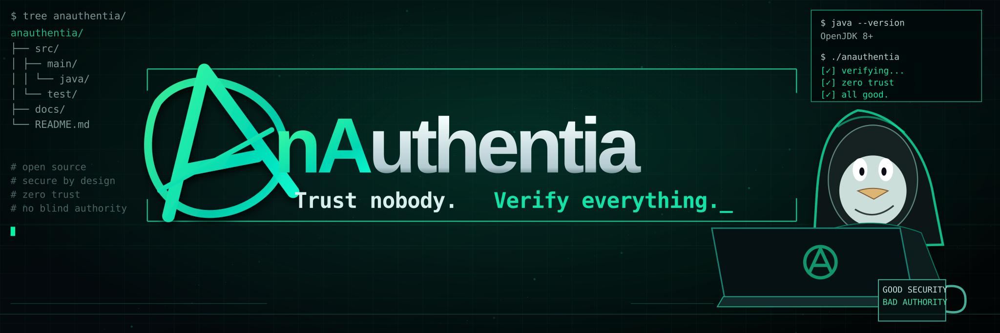

# AnAuthentia

**Trust nobody. Verify everything.**

*An OAuth 2.0 library for Java applications. No embedded server, no framework lock-in.*

> **Status: project bootstrap.** The reusable library and its public API are under development. No production-ready implementation or Maven Central artifact is published yet.

## Why AnAuthentia?

AskAI and Pyloros currently maintain separate OAuth implementations with overlapping responsibilities. **AnAuthentia** will extract the common, security-sensitive logic into one tested library, so both applications can share it without coupling their HTTP stacks.

The name is an intentionally mischievous play on *authentia* and anarchy. The logo is rebellious; the security model is not.

## Design goals

- **Library first:** no standalone HTTP server or centrally hosted identity provider.
- **Framework-independent core:** no runtime dependency on Vert.x, Spring, Swing, or a specific Java HTTP server.
- **Java 8 baseline:** usable from AskAI while remaining compatible with Pyloros on Java 21.
- **OAuth 2.0 authorization flows:** authorization codes, PKCE S256, client credentials validation, bearer tokens, and refresh-token lifecycle.
- **Security by default:** explicit redirect URI validation, fail-closed behavior, bounded token lifetimes, safe concurrency, and no credentials or tokens in logs.
- **Replaceable persistence and time:** interfaces for token storage, clocks, and other infrastructure that need deterministic tests.
- **Thorough tests:** concurrent requests, replay, expiry, rotation, invalid credentials, restart/persistence, and integration behavior.

## Planned integration

| Application | HTTP adapter | Java |
| --- | --- | --- |
| [AskAI](https://github.com/Miguel0888/askai-java8) | Existing Java HTTP server | 8+ |
| [Pyloros](https://github.com/aresstack/pyloros) | Vert.x routes | 21 |

Application-specific endpoints, configuration, and HTTP handling remain in those projects. The authorization logic and token lifecycle move into AnAuthentia.

## Roadmap

1. Extract and review the common OAuth domain model and interfaces.
2. Implement and test the framework-neutral core, addressing known security and concurrency risks.
3. Integrate AskAI and Pyloros using thin adapters and preserve their public OAuth contracts.
4. Publish a versioned Java artifact to Maven Central with API documentation and integration examples.
5. Reconsider centralizing authentication only if a genuine shared-service use case emerges.

## Using AnAuthentia

The dependency coordinates and Java API will be documented after the first tested release. **Do not deploy this repository as an authorization service yet.**

## Security

This is security-sensitive code. Changes to OAuth flows, PKCE, client authentication, token storage, or redirect handling require tests and review. Please avoid posting real client secrets, authorization codes, or bearer/refresh tokens in public issues or logs.

---

*Open source. Zero trust. A little anarchy in the artwork — none in the authorization rules.*

